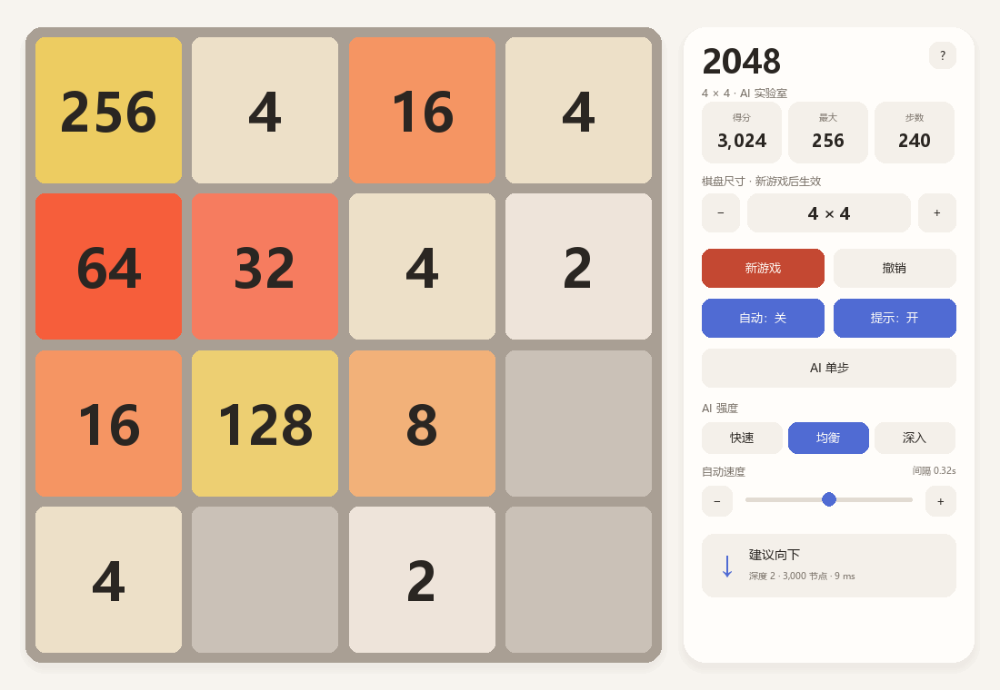

# Python2048 · AI Lab

一款可以亲手玩、让 AI 提示，也可以观察 AI 自动对局的桌面 2048。支持 3～40 阶棋盘，使用 Pygame 绘制界面，以 NumPy + Numba 加速 Expectimax 搜索。



- **自由游玩**：方向键、WASD 或鼠标滑动；可撤销最近 32 次有效移动。
- **观察 AI**：提示、单步、自动三种方式；三档搜索强度和五档自动速度。
- **适应窗口**：横屏、竖屏与紧凑布局；键盘导航、帮助面板和悬停详情。
- **方便复现**：固定随机种子、无头截图和轻量 CI 检查。

## 开始游戏

下载或克隆仓库后，在项目根目录运行以下命令。建议使用 **64 位 Python 3.12～3.14**；依赖范围见 [requirements.txt](requirements.txt)，无需 GPU。

Windows PowerShell（直接调用虚拟环境，无需修改脚本执行策略）：

```powershell
python -m venv .venv
.\.venv\Scripts\python.exe -m pip install -r requirements.txt
.\.venv\Scripts\python.exe main.py
```

macOS / Linux：

```bash
python3 -m venv .venv
./.venv/bin/python -m pip install -r requirements.txt
./.venv/bin/python main.py
```

使用 Conda 时，可运行 `conda env create -f environment.yaml`、`conda activate python2048`，再执行 `python main.py`。以下示例中的 `python` 均指已安装项目依赖的解释器。

**首次启动请稍等。** Numba 需要编译数值内核；后续启动会复用本地缓存。更新代码或依赖后可能重新编译。

## 操作说明

| 操作 | 键盘 / 鼠标 |
| --- | --- |
| 移动 | 方向键、WASD，或在棋盘内按住鼠标拖动 |
| 新游戏 | `R` / 新游戏按钮；所选阶数在此时生效 |
| 撤销 | `Z` / 撤销按钮；撤销时暂停自动模式 |
| AI 提示开关 / 单步 | `H` / `N`，或对应按钮 |
| 自动开关 | `Space` / `P`，或自动按钮 |
| 自动速度 | `+` / `-`、速度按钮或拖动滑块 |
| 查看帮助 | `F1` / `?` 按钮 |
| 切换控件 / 确认 | `Tab` / `Shift+Tab`，然后按 `Enter` |
| 查看格子 | 鼠标悬停于棋盘格子，查看数值详情 |
| 弹层确认 | `Enter`：确认所选按钮；默认继续 / 重开 / 关闭帮助 |
| 关闭弹层 / 退出 | `Esc`：关闭当前弹层；无弹层时退出 |

切换到其他窗口时，自动对局继续运行。手动移动、撤销、打开帮助或关闭自动开关会暂停自动模式。得分来自合并；步数只统计有效移动。首次合成 2048 后可继续挑战，无合法移动时结束。小格子会省略数字或使用简写，可以放大窗口或悬停查看详情；超大数字用 `2^指数` 显示。

**搜索强度控制计算量，自动速度控制目标间隔。** 实际节奏还受搜索耗时与动画影响。“深入”允许更多搜索工作，不保证每一步都更好；大棋盘会近似采样出生位置，详见 [AI 算法与限制](docs/ai.md)。

## 启动参数

```bash
python main.py --size 6 --seed 2048
python main.py --size 40 --seed 2048 --screenshot tmp/preview-40.png
python main.py --help
```

| 参数 | 用途 |
| --- | --- |
| `--size N` | 棋盘阶数，默认 4，范围 3～40 |
| `--seed N` | 固定随机种子；同一手动操作序列可复现 |
| `--screenshot [PATH]` | 无头绘制一帧、保存 PNG 后退出；默认 `python2048-screenshot.png` |
| `--ui-scale FACTOR` | 手动覆盖显示缩放，例如 `2`；通常使用自动设置即可 |

时间预算下的 AI 决策还受机器速度和缓存影响；仅固定 `--seed` 不保证自动对局完全相同。算法比较可使用固定节点预算。

## 常见问题

| 现象 | 处理方法 |
| --- | --- |
| 提示缺少 `pygame`、`numpy` 或 `numba` | 使用同一个虚拟环境解释器安装依赖并启动，避免混用系统 Python |
| 中文显示成方框 | 安装中文字体，如 Windows 微软雅黑、macOS 苹方、Linux Noto Sans CJK SC / 思源黑体，再重启程序 |
| PowerShell 拒绝运行 `Activate.ps1` | 使用上面的直接调用方式即可，无需激活脚本 |
| 更改阶数后棋盘没变 | 点击“新游戏”或按 `R`，新阶数才会应用 |
| 小窗口中数字看不清 | 放大窗口，或悬停查看格子详情；`F1` 查看操作说明 |
| AI 暂时不可用 | 查看面板中的错误信息，移动一步或重新开启提示后重试；提交 Issue 时附上复现步骤与环境 |

跨平台检查范围和界面验证限制见 [贡献指南](CONTRIBUTING.md#验证改动)，运行结果以仓库 Actions 记录为准。

## 开发与发布

- [架构与维护地图](docs/architecture.md)：模块职责、状态边界与修改入口。
- [AI 算法与限制](docs/ai.md)：预算、评分、近似采样与缓存。
- [GitHub 发布指南](docs/releasing.md)：首次上传、版本发布与仓库清理。
- [贡献指南](CONTRIBUTING.md)：问题反馈、验证方法和 Pull Request 要求。

## 许可证

本项目采用 [MIT 许可证](LICENSE)。
