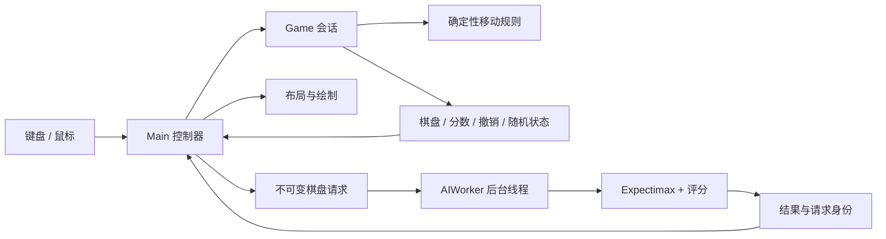

# 架构与维护地图

[返回 README](../README.md)

项目保留扁平模块结构，以 `python main.py` 启动。规则和搜索模块不依赖 Pygame；UI 模块不反向导入 `main.py`。

## 模块职责

| 层 | 模块 | 修改入口 |
| --- | --- | --- |
| 应用控制 | [main.py](../main.py)、[app_cli.py](../app_cli.py) | 输入、动画时序、AI 请求、启动参数 |
| 配置 | [config.py](../config.py)、[search_profiles.py](../search_profiles.py) | 窗口、配色、速度；搜索档位的唯一配置来源 |
| 确定性规则 | [game_rules.py](../game_rules.py) | 棋盘校验、合并、合法移动、出生概率 |
| 游戏会话 | [game.py](../game.py) | 随机出生、计分、步数、胜利状态、撤销 |
| 公共格式化 | [number_format.py](../number_format.py) | Game 与 UI 共用的整数和超大数文本格式，无 Pygame 依赖 |
| 搜索 | [ai.py](../ai.py) | Expectimax、预算、尺寸限制和采样 |
| 评分 | [ai_heuristic.py](../ai_heuristic.py)、[ai_numeric.py](../ai_numeric.py) | 指数表示、缓存、Numba 评分内核 |
| 后台工作 | [ai_worker.py](../ai_worker.py) | 不可变请求、结果与单后台线程 |
| 显示与布局 | [ui_display.py](../ui_display.py)、[ui_layout.py](../ui_layout.py) | SDL / DPI、坐标换算、窗口适配及普通 / 弹层控件区域 |
| 绘制与 UI 数据 | [ui_renderer.py](../ui_renderer.py)、[ui_fonts.py](../ui_fonts.py)、[ui_models.py](../ui_models.py) | 棋盘、面板、弹层、文字、动画与排队动作 |
| 自动检查 | [.github/workflows/ci.yml](../.github/workflows/ci.yml) | 语法、运行 API 和无头绘制 |

## 数据流

## 规则与会话边界

- `Board` 是不可变的方形整数元组；方块只能为 0 或从 2 开始的二次幂。公开入口接受整数协议，不悄悄截断浮点数或接受布尔值。
- `move_board` 不修改输入、不生成新块；每个方块沿移动方向至多合并一次。`simulate_move` 使用相同规则，省略动画轨迹。
- `Game.step` 只在有效移动后计步、保存撤销快照并生成一个方块；无效移动不消耗随机状态。
- 撤销同时恢复棋盘、分数、步数、胜利状态及随机数生成器状态；撤销后重复同一方向，应得到相同出生方块。
- 状态为 `running`、`won`、`over`。胜利只首次触发；继续挑战也要检查是否还有合法移动。
- 规则与得分使用 Python 任意精度整数。数值层储存方块指数，避免将真实大方块强转为固定宽度整数。

外部调用可以使用 `from game import Game, move_board`、`from ai import ExpectimaxAI, evaluate_board` 和 `from main import Main`。带前导下划线的辅助方法是内部实现；`simulate_move` 面向已验证的 `Board`。

## 输入、动画与异步边界

Pygame 和游戏状态仅在主线程操作。`AIWorker` 接收不可变快照，返回结果，不直接落子。

`Main.run` 每帧先执行 `update`，再绘制和刷新。`update` 先处理本帧输入，再执行动画队列、清理效果并处理 AI，使动画边界的新输入能替代旧的待执行方向。检查时序问题时，应从这一入口阅读。

控制器校验请求身份、棋盘版本、AI 配置版本和当前操作来源；棋盘变化、关闭自动、切换强度等操作不能让旧结果影响新状态。动画期间仅保留最新动作，并在执行时再次检查来源与版本。

关闭自动或提示仅取消对应用途的请求，保留其他用途的单步结果。已取消的请求仍占用在途位置，直到后台返回再丢弃，避免重复排队；存在待执行移动时，自动调度等待棋盘更新后再搜索。

动画、脉冲和得分效果由控制器推进与清理，绘制函数只观察状态。`PendingMove` 保留方向、来源、棋盘版本和配置版本；`BoardLayer`、`TileLayer` 命名缓存数据，减少无名称元组的隐式约定。

静态棋盘使用单份前景缓存层；缓存依赖棋盘版本、布局、缩放及主题，不能遗漏影响画面的参数。滑动和脉冲期间绘制动态内容，静态时复用整层。

## 显示与缓存边界

`ui_display` 需先于 Pygame 导入，以设置 SDL / DPI。窗口布局使用逻辑像素，绘制使用 Surface 像素；鼠标位置经过 `_surface_point` 转换。跨显示器或窗口尺寸变化后，重新取得 Surface 并计算布局。

弹层几何与按钮由 `LayoutMixin._layout_modal` 统一创建，键盘和鼠标事件处理前同步，绘制复用相同区域。这样同一帧打开弹层或调整窗口时，也使用当前命中区域。

数值缓存与渲染缓存都需要容量上限或明确失效条件。字体和文字图片按 LRU 淘汰最近最少使用的项目，避免达到容量后全量清空。文字、阴影和棋盘缓存属于 UI；规则、估值和搜索缓存属于计算层。基准比较应使用 `clear_search_caches()` 统一计算缓存起点。

## 修改前的配套检查

| 改动 | 同时确认 |
| --- | --- |
| 合并、计分、随机出生 | 正式与模拟移动一致；概率总和为 1；撤销重放可复现 |
| AI 权重与采样 | [AI 文档](ai.md)、节点预算、对称性、完整对局质量 |
| 搜索档位 | 修改 `search_profiles.py`，避免在 UI 再定义预算；同步档位表 |
| 快捷键或 AI 开关 | 帮助面板、README、关闭功能后的延迟响应检查 |
| 布局、文字与缓存 | 三种布局、最小窗口、40 阶、主题与缩放失效条件 |
| 依赖范围 | `requirements.txt`、`environment.yaml`、CI 安装结果与文档 |
